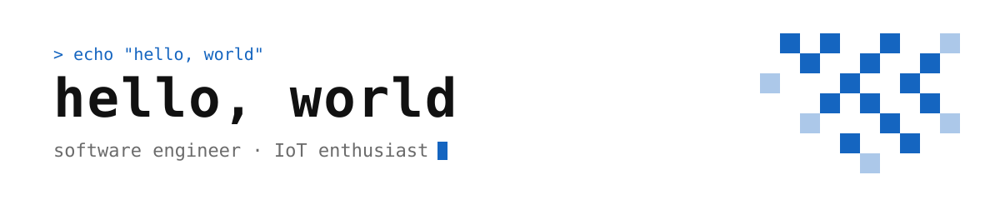

<picture>
  <source media="(prefers-color-scheme: dark)" srcset="./assets/banner-dark.svg">
  
</picture>

### About

- 👨‍💻 software engineer at [LexisNexis](https://www.lexisnexis.com/)
- 🐢 mostly **Node.js** and **TypeScript**, **Go** for side projects
- 🔌 tinkering with **IoT** and DIY hardware
- 🇨🇿 based in Prague, CZ

### Latest from the blog

<!-- BLOG-POST-LIST:START -->
- [Connecting Xiaomi thermometers to Home Assistant](https://jozefcipa.com/blog/connecting-xiaomi-thermometers-to-home-assistant/)
- [Three weeks in New Zealand](https://jozefcipa.com/blog/three-weeks-in-new-zealand/)
- [Meet Wordiez - a vocabulary app curated by you](https://jozefcipa.com/blog/meet-wordiez-a-vocabulary-app-curated-by-you/)
- [How I access my private homelab from the internet without a VPN](https://jozefcipa.com/blog/how-i-access-my-private-homelab-from-the-internet-without-a-vpn/)<!-- BLOG-POST-LIST:END -->

### Technologies

 

### Say hi

&nbsp;&nbsp;&nbsp;
&nbsp;&nbsp;&nbsp;
&nbsp;&nbsp;&nbsp;

